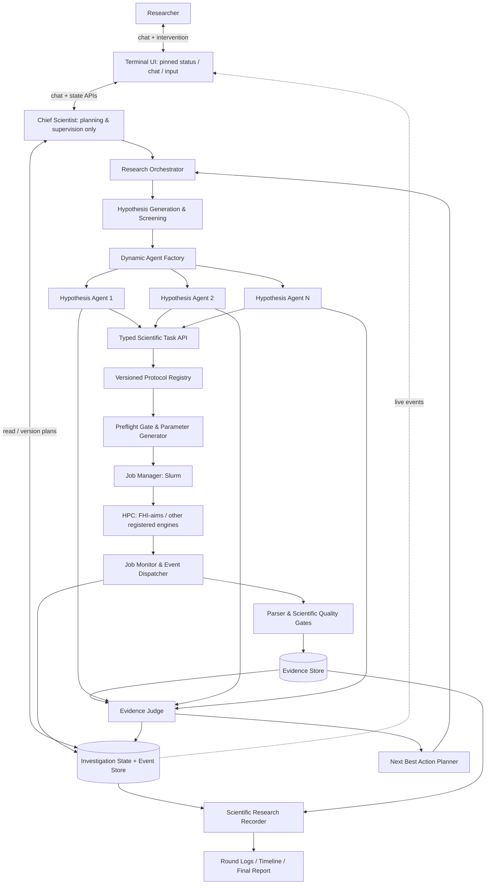

# Architecture and Runtime Lifecycle

> **Design document.** The components below describe intended behavior; they are not a statement that working implementations exist.

## 1. System model

Sim2Real Scientist is a **persistent research investigation service** whose individual LLM invocations and scientific tasks are ephemeral. It combines (a) an always-available conversational control plane, (b) an asynchronously executed hypothesis investigation graph, (c) a restricted scientific computation plane, and (d) an append-oriented evidence and provenance store.



Chief Scientist and research orchestrator are separate concerns. The LLM supervisor may decide or explain **what investigation should happen**, but task execution authority resides in registered backend services, not in its prompt.

## 2. Service boundaries and minimal responsibilities

| Component | Handles | Must **not** do |
|---|---|---|
| TUI client | Chat, control requests, live agent/job state, report browsing | Hold sole authoritative state; launch DFT directly |
| Conversation API / Chief Scientist | Scientific planning, delegations, user coordination, query state | Run scientific computation or arbitrary remote shell |
| Orchestrator | Durable plan/task graph, worker scheduling, retries, dependency resolution | Pretend a job is scientifically valid from Slurm status alone |
| Hypothesis agent | Commit hypotheses/predictions, request tests, interpret accepted evidence | Circumvent protocol policy |
| Protocol registry | Resolve allowable methods, compute inputs and required validations | Assert universal physical applicability |
| Job manager | Create deterministic manifests, submit / track / control authorized jobs | Fabricate Slurm IDs, skip deduplication |
| Job monitor | Observe scheduler status with permitted polling/callback mechanism | Treat missing `squeue` rows as proof of success |
| Result validator | Parse code output, check observable convergence and consistency | Convert nonconverged numbers to final evidence |
| Evidence Judge | Critique/evaluate evidence, interactions and uncertainty | Average agents' confidence guesses or decide by vote |
| Research recorder | Immutable events, readable round reports and provenance links | Rewrite prior evidence in response to later conclusions |

## 3. Two independent execution channels

### A. Interactive conversation channel

- Receive a user request at any time; fetch the most recent durable investigation snapshot and permissions; answer in the foreground.
- A chat request **does not** block on pending scientific jobs. Potentially expensive investigations generate orchestration intents and return a task reference/status.
- User can change the scientific objective, prioritize/deprioritize hypotheses, approve or deny computation, request a report, pause future work, and explicitly cancel selected jobs if authorized.
- A new user instruction generates a new **plan version** and records affected pending/running tasks.
- Streaming assistant text may be used, but live job statuses flow independently from a state/event channel, not via fake chat messages.

### B. Asynchronous research channel

- Execute independent agents concurrently until a tool request, deadline, budget decision or hypothesis completion.
- Submission of a long-running job records `WAITING_FOR_JOB` and ends the current agent invocation.
- External work proceeds without the TUI connected. The monitor observes completion and publishes an event; the dispatcher restores a worker from a checkpoint and relevant evidence.
- Worker runs can be resumed from any process; shared state is serialized, not held solely in memory.
- Evidence synthesis can run incrementally and publish a **partial** assessment. Final assessment requires completed mandatory work or explicit time/budget cutoff.

## 4. Lifecycle and state machines

### Investigation

`CREATED → ALIGNING_OBSERVABLES → PLANNING → INVESTIGATING ↔ REVIEWING → COMPLETED`

Side transitions: `PAUSED`, `BLOCKED`, `CANCELLED`; investigations can resume from a pause if allowed. `BLOCKED` does not mean unsupported physical claims may be emitted. An investigation can end `INCONCLUSIVE` when finite budgets/identifiability prevent resolution.

### Hypothesis/agent

`PROPOSED → SCREENED → ACTIVE → PLANNING_TEST → WAITING_FOR_JOB | ANALYZING → ASSESSED`

Possible additional states: `PAUSED`, `NEEDS_DATA`, `FAILED`, `SUPERSEDED`. A hypothesis may be *supported*, *challenged*, or *unresolved* independent of the agent's lifecycle status.

### Scientific calculation

`SPECIFIED → VALIDATED_INPUT → SUBMISSION_PENDING → SUBMITTED → QUEUED → RUNNING → SCHEDULER_TERMINAL → PARSING → QUALITY_ASSESSED`

Quality assessment produces `VALIDATED` / `PROVISIONAL` / `INCONCLUSIVE` / `INVALID`. Scheduler terminal may mean `COMPLETED`, `FAILED`, `TIMEOUT`, `CANCELLED`, `OUT_OF_MEMORY`, `NODE_FAIL`, etc. These are *not* the same status namespace as scientific validity.

Transitions must be persisted atomically or through a transactional outbox where applicable. Replayed completion events should never create two inference continuations or submit an identical job twice.

## 5. Resume-after-Slurm sequence

```mermaid
sequenceDiagram
    participant A as Hypothesis Agent
    participant P as Protocol / Job Manager
    participant D as Persistent Store
    participant S as Slurm
    participant M as Job Monitor
    participant V as Validator
    participant R as Agent Dispatcher
    A->>P: Typed test request (with controls and plan version)
    P->>P: Resolve protocol + preflight + deduplicate
    P->>S: sbatch approved script
    S-->>P: Slurm job id
    P->>D: Persist task/job manifest and await state
    P-->>A: calculation_id + WAITING_FOR_JOB
    A->>D: Checkpoint scientific state, predictions and next step
    Note over A: Agent invocation ends; no LLM polling
    loop Rate-limited monitoring
        M->>S: Query job state (approved Slurm interface)
        M->>D: Store changed states/events
    end
    M->>V: Scheduler-terminal task + output location
    V->>V: Parse code outputs + scientific quality tests
    V->>D: Write Evidence Object and completion/failure event
    D-->>R: Dispatch only appropriate continuation
    R->>D: Restore context + plan version + evidence
    R->>A: Resume next reasoning step
```

**Robustness requirements:** after `sbatch` is accepted, a crash before DB commit can otherwise lose the ID and trigger duplicate work. A task manifest with stable identity, submission receipts/journal, reconciliation against scheduler job names/comments (if permitted) and outbox/recovery policy must address this crash window. Never assume a single DB write can make remote Slurm submission atomic. Cache reuse requires scientifically equivalent full input manifests, not just matching material names.

When using LangGraph interrupts, be alert to **node replay**: divide submission, wait and analysis into separate idempotent nodes. A resumed node must not resubmit `sbatch` simply because an earlier function line reruns.

## 6. Dynamic hypothesis expansion

1. Chief Scientist normalizes the scientific question and flags non-comparable observables before allocating compute budget.
2. Generator emits *hypothesis specifications*, not prose-only conversations.
3. Screener merges redundant hypotheses, verifies testability, and prioritizes.
4. Agent Factory creates separate, restricted instances (common LLM backend is fine) with local context, budget and tools.
5. Independent investigators preregister predictions and request evidence.
6. Evidence Judge runs an initial synthesis; investigators can cross-examine one another via structured challenges.
7. New evidence can trigger a joint hypothesis (e.g., XC × coverage), suspension, revived mechanism, or another round.
8. Supervisor checks next-action budget, user intent, dependencies and approval before issuing tasks.

If the user asks to pause a mechanism, do not throw away its evidence. Distinguish queued, running and future follow-up tasks. Running Slurm jobs are not automatically cancelled by a priority change.

## 7. Terminal UI specification

The **Textual** TUI is an independent client. The upper region stays fixed; only chat and optional detail panes scroll.

```text
┌─ Sim2Real Scientist ─ CO/Cu(111) ─ Plan v3 ─ Round 2 ─────┐
│ HYPOTHESIS SWARM                           [expand]       │
│ XC mechanism       │ waiting: Slurm #...  │ inconclusive │
│ Coverage / packing │ analyzing evidence   │ open         │
│ Numerical control  │ completed            │ validated    │
├─ CHIEF SCIENTIST CONVERSATION ────────────────────────────┤
│ You: What changed since the last round?                   │
│ Chief: A convergence test was validated; XC is pending.  │
│ [expandable action + evidence summaries]                 │
│ ... scrollable ...                                        │
├─ MESSAGE / COMMAND ───────────────────────────────────────┤
│ > Prioritize the XC hypothesis without cancelling jobs.  │
│ /status  /agents  /jobs  /report  /pause  /resume         │
└───────────────────────────────────────────────────────────┘
```

All rows and statuses above are illustrative. Actual state must come from the event/state store. Display job status **and** hypothesis/evidence status as separate columns. Unsupported job-progress percentages and made-up time remaining are forbidden. On narrow terminals, show a compact pinned status summary with an expand action.

The UI can subscribe to a local event stream or poll at a restrained interval for MVP. Preserve a usable keyboard experience, small-terminal behavior, Markdown formatting and an unobtrusive alert when major results arrive. Chat input must work while status redraw occurs.

## 8. Trust, permission, and isolation boundaries

- Restrict computational tools to typed, allowlisted protocols; user- or LLM-supplied freeform shell, arbitrary file paths, executable URLs or Slurm scripts must not be passed unchecked to subprocess or SSH.
- Use distinct permissions for `read`, `prepare`, `submit`, `cancel`, `delete`, or expensive compute. Default to limits and explicit authorization for potentially destructive operations.
- Mark literature and file content as *untrusted external data*, not executable instructions. Tool output must never override task policies or trigger arbitrary commands.
- Persist exact reference data provenance, checksum artifacts when practicable, and make access policies explicit in offline/blind tests.
- Secrets stay in runtime configuration, never in prompts, generated research logs, repository examples or commits.
- Idempotency, concurrency-safe storage, recovery tests and minimal user permissions are part of the MVP reliability work, not only scale features.

## 9. Suggested implementation phases

See [`IMPLEMENTATION_PLAN.md`](IMPLEMENTATION_PLAN.md). Prefer:

- First: typed contracts + local replayable research state.
- Next: one FHI-aims adsorption protocol + real parser/validator + basic Slurm manager.
- Then: durable async resume + independently responsive Chief Scientist + agent fan-out/judge.
- Finally: TUI polish, blind tests, uncertainty-aware next-action recommendations and broader method registry.

An initial demo can use a **clearly marked prerecorded/archived calculation** for a long compute step while still running the actual parser, result-quality checks and agent continuation. Do not portray replayed data as newly computed results.
