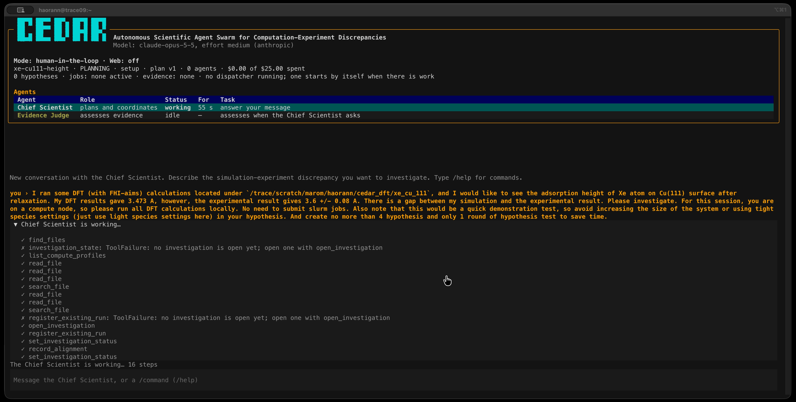
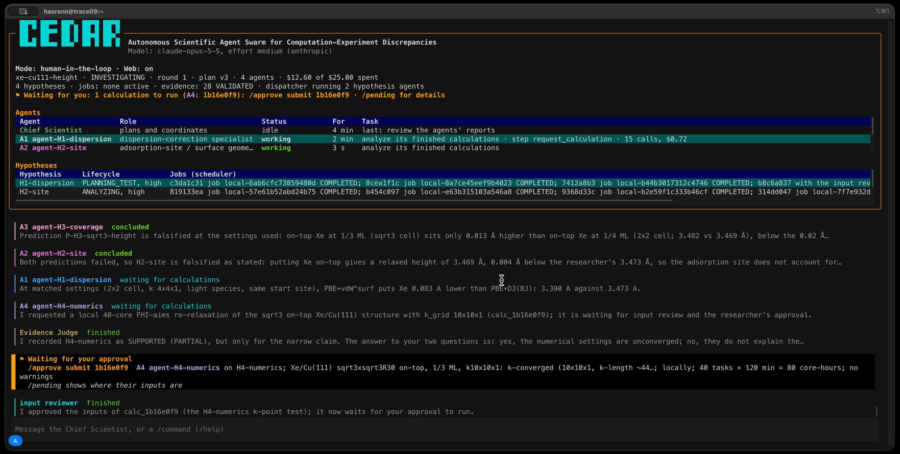

# CEDAR

**Autonomous Scientific Agent Swarm for Computation-Experiment Discrepancies**

*Built for the 2026 Open Scientific Intelligence Hackathon.*

<table>
  <tr>
    <td width="33%"><a href="figures/CEDAR%20Scientist%20Research%20System%20Infographic.png"></a></td>
    <td width="33%"><a href="figures/gallary_1.png"></a></td>
    <td width="33%"><a href="figures/gallary_2.png"></a></td>
  </tr>
  <tr>
    <td align="center"><sub>Design overview</sub></td>
    <td align="center"><sub>Opening an investigation</sub></td>
    <td align="center"><sub>Agents report; a calculation waits for approval</sub></td>
  </tr>
</table>

Computational models and experimental measurements often disagree. The disagreement may arise from an approximation in the electronic-structure method, an idealized atomic structure, finite-temperature or environmental effects, an incorrect comparison of observables, numerical inaccuracies, or several interacting causes. A plausible explanation is not necessarily a verified explanation.

**CEDAR** is a human-guided research system that investigates these discrepancies as scientific questions. You describe the discrepancy to a conversational **Chief Scientist**, which proposes one agent per hypothesis. Each agent commits to falsifiable predictions, writes and requests DFT calculations (FHI-aims or VASP, through Slurm or on an interactive node), reads the outputs and reports what its results do—and do not—establish. Every calculation is checked before it runs and needs your approval to start; every number that becomes evidence is traced to the output lines or analysis script it came from. An **Evidence Judge** assesses the hypotheses, and a Markdown research notebook records each round.

CEDAR is an early prototype. It has not been validated as producing correct scientific conclusions.

## Requirements

- Linux, with Python 3.12 or later (conda is the simplest way to get it)
- an API key from Anthropic or OpenAI, or both
- for calculations: a cluster with Slurm and FHI-aims or VASP installed
- recommended: [bubblewrap](https://github.com/containers/bubblewrap) (`bwrap`) on the machine CEDAR runs on, to sandbox the commands and analysis scripts agents run. Without it, agents can run only Python scripts, under a weaker guard.

## Installation

**1. Get the code and create an environment**

```bash
git clone https://github.com/haoran-ni/CEDAR.git cedar
cd cedar
conda create -n cedar python=3.12
conda activate cedar
pip install -e .
cedar --version
```

On a cluster you may first need to load conda as a module (`module load ...`). If `conda activate` complains that your shell is not set up, run `conda init bash` once and open a new terminal. Any other Python 3.12 environment, such as a `venv`, works as well.

To use `cedar` without activating the environment, link it onto your `PATH` while the environment is active:

```bash
ln -s "$(which cedar)" ~/.local/bin/cedar
```

**2. Add your API key**

```bash
cedar auth add anthropic        # prompts for the key without showing it
cedar auth add openai           # only if you use OpenAI models
cedar auth status               # shows which keys CEDAR will use
```

Keys are stored in `~/.config/cedar/credentials.toml`, readable only by you. If `ANTHROPIC_API_KEY` or `OPENAI_API_KEY` is set in your environment, it takes precedence.

**3. Choose the models**

```bash
cedar models init               # writes ~/.config/cedar/models.toml
cedar models check              # sends one tiny request to confirm the key and model work
cedar models show               # lists each role's model and its prices
```

The starter file uses Claude Opus 5.5 for every agent. Edit it to give a role its own model, for example:

```toml
[roles.default]
provider = "anthropic"
model = "claude-opus-5-5"
effort = "medium"

[roles.hypothesis_agent]
provider = "openai"
model = "gpt-5.6-sol"
effort = "medium"
```

The roles are `chief_scientist`, `hypothesis_agent`, `evidence_judge`, `input_reviewer`, `approver` and `environment_setup`. Any role without its own section uses `default`. CEDAR knows the prices of the current Claude models and of GPT-5.6 Sol; for any other model, add a `[roles.<role>.prices]` section (the starter file shows how), or CEDAR cannot keep a budget. `cedar models check --role <role>` checks one role's model.

**4. Describe your cluster**

Nothing runs on the cluster until you approve a compute profile: how each code is run, the job-script template, the allowed partitions and the resource limits. An environment-setup agent proposes one by reading your existing job scripts and asking you questions in the terminal:

```bash
cedar setup --name mycluster
cedar profile show mycluster    # review the proposal and its checks
cedar profile approve mycluster
```

The setup agent stops after spending $15 on its model (`--max-cost` changes this); `cedar setup --name mycluster --resume` continues an interrupted session. `cedar profile list` lists your profiles.

**5. Start CEDAR**

```bash
cedar start
```

## Using CEDAR

### An investigation, step by step

1. **Describe the discrepancy.** Tell the Chief Scientist what you computed, what was measured, and where your files are, in plain language. For example: *"My FHI-aims runs under `/scratch/me/xe_cu111` give a Xe adsorption height of 3.473 Å on Cu(111); experiment gives 3.6 ± 0.08 Å. Please investigate."* You can also set limits here, such as which species defaults to use or how many hypotheses to test.
2. **Review the proposed agents.** The Chief Scientist opens an investigation, reads and registers the runs you point it to, and proposes hypotheses with one agent each. `/agents` shows the proposal. The agents start after a 10-minute review window, or at once with `/approve agents`. Any message you send in the meantime holds them until the Chief Scientist revises the proposal.
3. **Approve calculations.** Agents write inputs and request calculations. Each request is checked against your compute profile and read by an input-reviewer agent; then it waits for you. `/pending` shows what each calculation computes, where it runs, its size in core-hours, and the directory with its inputs. Approve it with `/approve submit <calc>`, or refuse it with `/reject inputs <calc> <reason>`, which sends your reason back to the agent.
4. **Let it run.** Agents stop while their jobs run, spending nothing, and are woken when the jobs end. You can close the chat: a background dispatcher keeps submitting approved work and following jobs. `cedar start <investigation>` reopens the investigation where it was.
5. **Read the results.** When the agents report, the Chief Scientist compares the hypotheses and tells you where each stands. Ask it anything at any time: status, reasoning, evidence, alternative tests, or a change of priorities. Read the full record with `/notebook`.
6. **Close it.** The Chief Scientist proposes closing the investigation when the evidence is in; only `/approve close` closes it.

To run calculations on an interactive node instead of submitting Slurm jobs, start CEDAR inside a Slurm allocation (for example with `salloc`). Local calculations use all but 4 of the allocation's cores, which stay free for the agents' commands. DFT never runs on a login node.

### The terminal interface

The window has three parts:

- **Panel (top):** the mode, budget and status lines; a table of agents with their status, for how long, and their current task; and a table of hypotheses with their lifecycle, scheduler jobs, evidence and assessment, kept in separate columns. A highlighted line says what is waiting for you.
- **Conversation (middle):** your chat with the Chief Scientist. Other agents' messages appear behind a bar in their own colour, and requests for your approval appear in a highlighted block with the command to run.
- **Input box (bottom):** type a message to the Chief Scientist, or a command starting with `/`.

Keys:

- Typing `/` opens a menu of matching commands: `↑`/`↓` choose, `Tab` or `Enter` completes, `Esc` closes the menu. `Enter` on a complete command runs it.
- `Tab` moves focus to the panel; `Enter` on a hypothesis opens its notebook page.
- On a notebook page, links open the cited output lines and other pages; `Backspace` goes back and `Esc` closes the page.

`cedar start --plain` gives a line-by-line chat instead, for terminals that cannot show the full-screen interface.

### Chat commands

Anything that does not start with `/` goes to the Chief Scientist. A `<calc>` can be given by the first characters of its id (the interface shows 8), and an `<agent>` by its number, such as `A2`.

**Status and records**

| Command | What it does |
|---|---|
| `/status` | Show the investigation's state |
| `/agents` | Show the hypothesis agents, and any the Chief Scientist proposes |
| `/pending` | Show what waits for your approval, and requests from agents |
| `/report` | Update the research notebook and show where it is |
| `/notebook` | Open the notebook's index *(full-screen interface only)* |
| `/round` | Open this round's notebook page *(full-screen interface only)* |
| `/timeline` | Open the timeline of every event *(full-screen interface only)* |
| `/panel` | Hide or show the panel's tables *(full-screen interface only)* |
| `/help` | List the commands |
| `/quit`, `/exit` | Leave; queued work and jobs continue with the dispatcher |

**Approvals**

| Command | What it does |
|---|---|
| `/approve agents` | Start the proposed agents now, instead of after the review window |
| `/approve submit <calc>` | Let a calculation run, once the input reviewer has finished with it |
| `/approve submit <agent>` | Let every calculation one agent is waiting for run |
| `/approve submit all` | Let every waiting calculation run; ones the reviewer warned about only after `/pending` has shown them |
| `/reject inputs <calc> <reason>` | Refuse a calculation's inputs; the reason goes to the agent |
| `/cancel <calc> <reason>` | Cancel a calculation, stopping its job if it has one |
| `/approve close` | Close the investigation for good, as the Chief Scientist proposes |

**Settings**

| Command | What it does |
|---|---|
| `/mode` | Show the mode: human-in-the-loop, or full automation and what it has left |
| `/mode full-automation <core-hours> <dollars>` | While you are away, an approver agent decides on agents and submissions within these limits, and the Evidence Judge assesses new evidence every round |
| `/mode human-in-the-loop` | Take the decisions back |
| `/budget` | Show what the agents have spent on models, and the budget |
| `/budget <dollars>` | Limit what all agents of the investigation may spend on models (default $25) |
| `/budget off` | Remove the limit |
| `/web` | Show whether agents may use the web |
| `/web on` | Let the Chief Scientist and the hypothesis agents search and read the web |
| `/web only <domains>` | The same, limited to these domains, e.g. `arxiv.org doi.org` |
| `/web off` | No web for any agent (the default) |
| `/workbench` | Show whether agents may run commands in their workspaces |
| `/workbench on` | Let them (the default): sandboxed, no network, no DFT, writing only in their own workspace |
| `/workbench off` | No commands for any agent of this investigation |

**Data**

| Command | What it does |
|---|---|
| `/attach <path> <note>` | Give the agents an image, PDF or text file to view, such as a figure, paper or measured data; the note is optional |
| `/materials` | List the files you attached |
| `/register <dir> <note>` | Register a finished FHI-aims or VASP run computed outside CEDAR, so evidence can come from it; add `--output <file>` if its output is not `aims.out` or `OUTCAR` |

**Stopping**

| Command | What it does |
|---|---|
| `/halt <reason>` | Stop this investigation now: cancel its jobs, retire its agents and pause it |
| `/halt all <reason>` | The same for every investigation, and stop the background dispatcher |

In full automation, calculations whose inputs need your look, `/reject inputs`, `/cancel`, `/approve close` and `/halt` still stay with you. `/budget`, `/web`, `/attach`, `/materials` and `/halt all` also work before an investigation has been opened.

### Command-line reference

| Command | What it does |
|---|---|
| `cedar start [<investigation>]` | Talk with the Chief Scientist, in a new or an existing investigation. `--plain` for a line-by-line chat; `--no-dispatch` to run the dispatcher yourself |
| `cedar investigations` | List investigations and their state |
| `cedar report [<investigation>]` | Write the research notebook from the event log |
| `cedar auth add\|remove <provider>`, `cedar auth status` | Manage API keys (`anthropic`, `openai`) |
| `cedar models init\|show\|check` | Write, list or test the model configuration |
| `cedar setup --name <profile>` | Let the environment-setup agent propose a compute profile |
| `cedar profile list\|show\|approve` | Review and approve compute profiles |
| `cedar dispatch` | Run the dispatcher in the foreground. `--agents N` (default 4) agents at once, `--interval` seconds between passes (default 60), `--once` for one pass, `--stop` to stop a running one |
| `cedar reset` | Delete every investigation and its history; keep profiles, models and keys |
| `cedar purge` | Delete everything CEDAR stored, including the setup and API keys |

`cedar start` launches a dispatcher in the background whenever there is work for one. It keeps going after you close the chat and stops by itself after 30 idle minutes; its log is in the data directory. If you prefer to manage it yourself, run `cedar start --no-dispatch` and `cedar dispatch` in tmux or screen.

### Where things are stored

| What | Where | Override |
|---|---|---|
| Keys, models, compute profiles | `~/.config/cedar` | `CEDAR_CONFIG_DIR` |
| Event log, stored files, transcripts, notebooks | `~/.local/share/cedar` | `CEDAR_DATA_DIR` |

Each investigation's notebook starts at `~/.local/share/cedar/notebooks/<investigation>/index.md`.

### Starting over

`cedar reset` and `cedar purge` list what they will delete and ask you to type the command's name (`--yes` skips this). Run directories, with the calculations' inputs and outputs, are kept unless you add `--runs`. Neither deletes anything while a dispatcher is running or a calculation CEDAR started has not ended: wait for it, or add `--cancel-jobs`. `pip uninstall cedar` removes the program itself.

## Further reading

- [`AGENTS.md`](AGENTS.md): the design and implementation contract
- [`docs/`](docs/): architecture, scientific protocols, evidence and provenance, analysis scripts, and the workbench

To run the tests: `pip install -e ".[dev]"`, then `pytest`.
