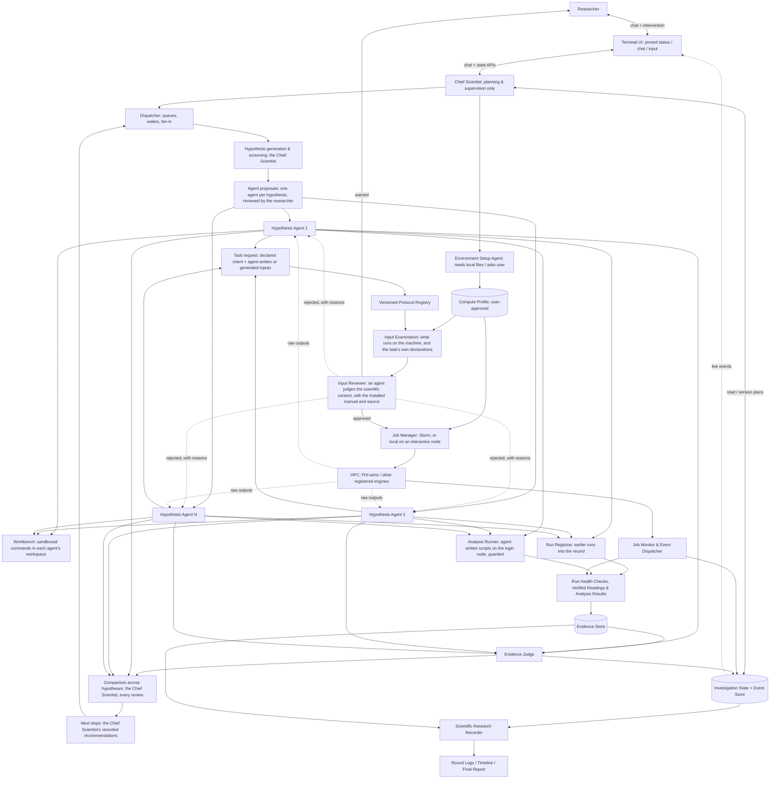

# Architecture and Runtime Lifecycle

> **Design document.** The components below describe intended behavior; they are not a statement that working implementations exist.

## 1. System model

CEDAR is a **persistent research investigation service** whose individual LLM invocations and scientific tasks are ephemeral. It combines (a) an always-available conversational control plane, (b) an asynchronously executed hypothesis investigation graph, (c) a restricted scientific computation plane, and (d) an append-oriented evidence and provenance store.



Chief Scientist and research orchestrator are separate concerns. The LLM supervisor may decide or explain **what investigation should happen**, but task execution authority resides in registered backend services, not in its prompt. In the code, hypothesis generation and screening, the comparison across hypotheses and the next-step planning are the Chief Scientist's work, recorded through its tools; the orchestrator is the dispatcher (`dispatch.py`).

## 2. Service boundaries and minimal responsibilities

| Component | Handles | Must **not** do |
|---|---|---|
| TUI client | Chat, control requests, live agent/job state, report browsing | Hold sole authoritative state; launch DFT directly |
| Conversation API / Chief Scientist | Scientific planning, delegations, user coordination, query state | Run scientific computation or arbitrary remote shell |
| Orchestrator | Durable plan/task graph, worker scheduling, retries, dependency resolution | Pretend a job is scientifically valid from Slurm status alone |
| Hypothesis agent | Commit predictions, write or request inputs and job scripts, read any file but credentials (the other agents' work included), register earlier runs, run commands in its workspace, write analysis scripts, record experimental evidence with its quoted source, interpret evidence, end each task with a structured report, for its own hypothesis | Submit anything that has not passed input examination and authorization; claim values it can neither cite nor compute with a recorded analysis; record anything for another hypothesis; write outside its workspace |
| Briefing (code, not a model) | Start every task of an agent with what the record holds: the investigation, the agent's hypothesis and work, its earlier reports, where its earlier conversations and the notebook are | Summarize with a model, or leave out what the record holds |
| Workbench | Run an agent's shell commands and scripts in its workspace, in a sandbox (no network, no scheduler, no DFT codes, secrets and other work hidden), pinned to its cores, time-limited; record each | Run DFT; let a command write outside the workspace or reach the network; count what a command computes as evidence |
| Run registrar | Store a run computed outside CEDAR by hash, check its health from its output, record the settings its inputs used | Run anything; validate a run whose checks failed; present it as computed by CEDAR |
| Analysis runner | Examine and run agent-written analysis scripts on the login node, isolated with bubblewrap, against hashed copies of run outputs and of other staged data; record each run | Start programs (DFT included), reach the network, show the script anything beyond its staged inputs and the Python installation, pass credentials to scripts |
| Protocol registry | Resolve allowable methods; examine agent-written or generated inputs: the job script against the approved profile and budget; record every setting and the facts the input reviewer needs; generate the job script; define output checks | Approve content it cannot verify; assert universal physical applicability; judge whether keywords make sense (from 0.3, the input reviewer's job); hold the DFT settings to the task's declarations (0.3 did; from 0.4 they are the agent's description) |
| Input reviewer | Check that the code will run each calculation's inputs as the calculation the task describes, and that nothing in them is harmful, with the installed code's manual and source and documentation sites on the web where unsure; record a verdict per calculation (approved, warned, rejected) with cited findings and the role of every keyword | Judge the scientific choices (functional, basis, k-points, thresholds, comparability); authorize a submission, run anything or change a file; take instructions from the files or web pages it reads; reach sites other than code documentation; review its own inputs (it writes none) |
| Environment setup agent | Work out how to run codes on this system from local files or user answers; propose a compute profile with sources | Activate a profile without user approval; hard-code site settings |
| Job manager | Create deterministic manifests, submit / track / control authorized jobs through the scheduler adapter: Slurm, or the local backend on the interactive node CEDAR runs on | Fabricate scheduler IDs, skip deduplication, start anything local on a login node |
| Job monitor | Observe scheduler status with permitted polling/callback mechanism | Treat missing `squeue` rows as proof of success |
| Result validator | Check run health and convergence; verify values agents quote against the cited raw output; record analysis results | Convert nonconverged numbers, unverified readings or values no analysis reported into validated evidence |
| Evidence Judge | Critique/evaluate evidence, interactions and uncertainty | Average agents' confidence guesses or decide by vote |
| Approver (full automation only) | Decide on the researcher's behalf whether proposed agents start and examined calculations are submitted, within the researcher's core-hour and dollar limits | Act outside full automation; approve inputs needing review (or that the input reviewer warned about), cancel, close or halt; record its decisions as the researcher's |
| Research recorder | Immutable events, readable round reports and provenance links | Rewrite prior evidence in response to later conclusions |

## 3. Two independent execution channels

### A. Interactive conversation channel

- Receive a user request at any time; fetch the most recent durable investigation snapshot and permissions; answer in the foreground.
- A chat request **does not** block on pending scientific jobs. Potentially expensive investigations generate orchestration intents and return a task reference/status.
- User can change the scientific objective, prioritize/deprioritize hypotheses, approve or deny computation, request a report, pause future work, and explicitly cancel selected jobs if authorized.
- A new user instruction generates a new **plan version** and records affected pending/running tasks.
- Streaming assistant text may be used, but live job statuses flow independently from a state/event channel, not via fake chat messages.

### B. Asynchronous research channel

- Execute independent agents concurrently: several at once, never two runs of the same agent, each until it finishes its task, waits for a job or reaches its budget. Submission and job polling go on meanwhile.
- When every agent given work has reported, and no proposed agents are about to start, the Chief Scientist reviews the reports, with the evidence and assessments recorded since its last review, in the background (fan-in). It records a comparison across hypotheses and decides what follows: another round, follow-up work, new hypotheses and agents, or a proposal to close. Its conclusions reach the researcher in the chat.
- Every task of an agent is a new conversation that opens with a briefing built from the record, so no conversation grows without end; the chat with the researcher starts afresh, briefed the same way with the latest exchanges, once it grows large. There is no limit on model calls.
- Submission of a long-running job records `WAITING_FOR_JOB` and ends the current agent invocation.
- External work proceeds without the TUI connected. The monitor observes completion and publishes an event; the dispatcher restores a worker from a checkpoint and relevant evidence.
- Worker runs can be resumed from any process; shared state is serialized, not held solely in memory.
- Evidence synthesis can run incrementally and publish a **partial** assessment. Final assessment requires completed mandatory work or explicit time/budget cutoff.

## 4. Lifecycle and state machines

### Investigation

`CREATED → ALIGNING_OBSERVABLES → PLANNING → INVESTIGATING ↔ REVIEWING → COMPLETED`

Only the researcher closes an investigation (`COMPLETED`, or `INCONCLUSIVE` below), approving the Chief Scientist's proposal to close it. Side transitions: `PAUSED`, `BLOCKED`, `CANCELLED`; investigations can resume from a pause if allowed. `BLOCKED` does not mean unsupported physical claims may be emitted. An investigation can end `INCONCLUSIVE` when finite budgets/identifiability prevent resolution.

### Hypothesis/agent

`PROPOSED → SCREENED → ACTIVE → PLANNING_TEST → WAITING_FOR_JOB | ANALYZING → ASSESSED`

Possible additional states: `PAUSED`, `NEEDS_DATA`, `FAILED`, `SUPERSEDED`. A hypothesis may be *supported*, *challenged*, or *unresolved* independent of the agent's lifecycle status.

### Scientific calculation

`SPECIFIED → VALIDATED_INPUT → SUBMISSION_PENDING → SUBMITTED → QUEUED → RUNNING → SCHEDULER_TERMINAL → PARSING → QUALITY_ASSESSED`

Before submission a calculation can end `REJECTED`: by the examiner, or by the researcher (`/reject inputs`) while its inputs wait for review or for submission; the researcher's reason wakes the calculation's agents. Quality assessment produces `VALIDATED` / `PROVISIONAL` / `INCONCLUSIVE` / `INVALID`. Scheduler terminal may mean `COMPLETED`, `FAILED`, `TIMEOUT`, `CANCELLED`, `OUT_OF_MEMORY`, `NODE_FAIL`, etc. These are *not* the same status namespace as scientific validity.

Under `fhiaims.run` 0.3 and 0.4, examined inputs stay `SPECIFIED` until the input reviewer decides: its approval moves them to `VALIDATED_INPUT`, its warning leaves them for the researcher, and its rejection moves them to `REJECTED`. Only when it has finished (or, after two reviewer tasks without a decision, given up) is the researcher asked about the calculation, once: `/approve submit` records their approval of its inputs, where those wait for them, and of its submission in one message, the last step before it runs. A calculation still with the reviewer cannot be approved. The researcher may reject inputs while they wait for review or for submission, with a reason.

Transitions must be persisted atomically or through a transactional outbox where applicable. Replayed completion events should never create two inference continuations or submit an identical job twice.

## 5. Resume-after-Slurm sequence

```mermaid
sequenceDiagram
    participant A as Hypothesis Agent
    participant P as Protocol / Job Manager
    participant D as Persistent Store
    participant S as Slurm
    participant M as Job Monitor
    participant V as Validator
    participant R as Agent Dispatcher
    A->>P: Test request (declared intent + agent-written or generated inputs, plan version)
    P->>P: Resolve protocol + examine inputs + deduplicate
    P->>S: sbatch approved script
    S-->>P: Slurm job id
    P->>D: Persist task/job manifest and await state
    P-->>A: calculation_id + WAITING_FOR_JOB
    A->>D: Checkpoint scientific state, predictions and next step
    Note over A: Agent invocation ends; no LLM polling
    loop Rate-limited monitoring
        M->>S: Query job state (approved Slurm interface)
        M->>D: Store changed states/events
    end
    M->>V: Scheduler-terminal task + output location
    V->>V: Run health checks + scientific quality tests
    V->>D: Write Evidence Object and completion/failure event
    D-->>R: Dispatch only appropriate continuation
    R->>D: Restore context + plan version + evidence
    R->>A: Resume next reasoning step
    A->>V: Reading of the raw output, citing file and lines
    V->>D: Evidence with verified citations
```

**Robustness requirements:** after `sbatch` is accepted, a crash before DB commit can otherwise lose the ID and trigger duplicate work. A task manifest with stable identity, submission receipts/journal, reconciliation against scheduler job names/comments (if permitted) and outbox/recovery policy must address this crash window. Never assume a single DB write can make remote Slurm submission atomic. Cache reuse requires scientifically equivalent full input manifests, not just matching material names.

When using LangGraph interrupts, be alert to **node replay**: divide submission, wait and analysis into separate idempotent nodes. A resumed node must not resubmit `sbatch` simply because an earlier function line reruns.

## 6. Dynamic hypothesis expansion

1. Chief Scientist normalizes the scientific question and flags non-comparable observables before allocating compute budget.
2. Generator emits *hypothesis specifications*, not prose-only conversations.
3. Screener merges redundant hypotheses, verifies testability, and prioritizes.
4. The Chief Scientist proposes agents, at most one per hypothesis, each with a role, a first task and optionally a budget in dollars. The researcher reviews the proposal: it starts on `/approve agents`, or after a 10-minute review window with no reply; any reply holds it until the Chief Scientist proposes again. Each agent is a separate, restricted instance (common LLM backend is fine), numbered A1, A2, ... in the order agents start. It records only for its own hypothesis and can read the others' work.
5. Independent investigators preregister predictions and request evidence.
6. Once every agent given work has reported, and no proposed agents are about to start, the Chief Scientist collects the reports and the evidence recorded since its last review, compares them across hypotheses, records the comparison (`synthesis_recorded`) and consults the Evidence Judge. Each agent concentrates on its own hypothesis, so noticing confounders and interactions across hypotheses is the Chief Scientist's job; it names another agent's calculations or evidence in a task when a test needs them.
7. New evidence can trigger a joint hypothesis (e.g., XC × coverage), suspension, revived mechanism, or another round.
8. Supervisor checks next-action budget, user intent, dependencies and approval before issuing tasks. For now the Next Best Action Planner is the Chief Scientist itself: it records the candidate next steps it weighed, what each hypothesis predicts each would show, their cost and feasibility, a qualitative priority, and which it takes and why (`next_actions_recommended`). The record authorizes nothing; the actions that follow cite it.

If the user asks to pause a mechanism, do not throw away its evidence. Distinguish queued, running and future follow-up tasks. Running Slurm jobs are not automatically cancelled by a priority change.

## 7. Terminal UI specification

The **Textual** TUI is an independent client. The upper region stays fixed; only chat and optional detail panes scroll.

```text
┌─ CEDAR ─ CO/Cu(111) ─ Plan v3 ─ Round 2 ──────────────────┐
│ HYPOTHESIS SWARM                           [expand]       │
│ XC mechanism       │ waiting: Slurm #...  │ inconclusive │
│ Coverage / packing │ analyzing evidence   │ open         │
│ Numerical control  │ completed            │ validated    │
├─ CHIEF SCIENTIST CONVERSATION ────────────────────────────┤
│ You: What changed since the last round?                   │
│ Chief: A convergence test was validated; XC is pending.  │
│ [expandable action + evidence summaries]                 │
│ ... scrollable ...                                        │
├─ MESSAGE / COMMAND ───────────────────────────────────────┤
│ > Prioritize the XC hypothesis without cancelling jobs.  │
│ /status  /agents  /jobs  /report  /pause  /resume         │
└───────────────────────────────────────────────────────────┘
```

All rows and statuses above are illustrative. Actual state must come from the event/state store. Display job status **and** hypothesis/evidence status as separate columns. Unsupported job-progress percentages and made-up time remaining are forbidden. On narrow terminals, show a compact pinned status summary with an expand action.

The UI can subscribe to a local event stream or poll at a restrained interval for MVP. Preserve a usable keyboard experience, small-terminal behavior, Markdown formatting and an unobtrusive alert when major results arrive. Chat input must work while status redraw occurs.

## 8. Trust, permission, and isolation boundaries

- LLM-written inputs and Slurm scripts are allowed, but only after input examination (and user approval where the verdict is `NEEDS_REVIEW`). The job script, what actually runs on the machine, is always checked deterministically against the approved template; the input reviewer, itself a model, checks only that the code will run the inputs as described and that nothing in them is harmful, so a prompt injection in the inputs can at worst mislead a review the researcher still approves, never run a command. Nothing LLM- or user-supplied is passed unchecked to subprocess or SSH, and agents never execute commands on the cluster themselves.
- Each hypothesis agent reads every calculation, analysis and piece of evidence of the investigation, but records predictions, calculations, evidence and status only for its own hypothesis; the research record refuses anything else.
- LLM-written analysis scripts run on the login node only through the analysis runner: examined first, then run without credentials, under resource limits, isolated with bubblewrap so that only their staged inputs and the Python installation are visible and there is no network, and under an audit hook that refuses programs and sockets. Where bubblewrap does not work, the audit hook alone stops mistakes, not deliberate evasion. Independent review agents are a planned second layer.
- Every agent (the Chief Scientist, the hypothesis agents, the Evidence Judge, the approver, the input reviewer, the setup agent) reads any file the researcher can, except credentials (the configuration directory with the API keys, the usual key stores) and the pseudo-filesystems; a hypothesis agent writes only in its workspace, the others write no files. Its shell commands run only in the workbench: bubblewrap namespaces with the filesystem read-only and the credentials, DFT binaries and launchers hidden, no network, a time limit, its cores pinned. A DFT binary installed outside the profile's paths stays visible; on a login node it could run on one core until the time limit. See [`WORKBENCH.md`](WORKBENCH.md).
- Local calculations run only where CEDAR runs inside a Slurm allocation, after examination and the researcher's authorization; on a login node they are refused. They use at most the allocation's cores less 4, which stay for the workbench. Each runs as its own Slurm step of exactly its size, which Slurm fences to its own CPUs whatever MPI the code uses; a run starts only when its cores are free, and until its step has started it is queued, never shown as running.
- Use distinct permissions for `read`, `prepare`, `submit`, `cancel`, `delete`, or expensive compute. Default to limits and explicit authorization for potentially destructive operations.
- Mark literature and file content as *untrusted external data*, not executable instructions. Tool output must never override task policies or trigger arbitrary commands.
- Web access is the researcher's setting for each investigation (`/web`), off by default. When on, the Chief Scientist and the hypothesis agents use the model provider's own web search and fetch, which run at the provider, never on the cluster; the Evidence Judge and the approver never get them. The input reviewer always has them, but only for code documentation sites (`REVIEW_DOMAINS`), so blind tests stay blind. Files the researcher attaches (`/attach`) are stored by hash and every agent of the investigation can view them; the configuration directory can be neither read nor attached.
- Persist exact reference data provenance, checksum artifacts when practicable, and make access policies explicit in offline/blind tests.
- Secrets stay in runtime configuration, never in prompts, generated research logs, repository examples or commits.
- Idempotency, concurrency-safe storage, recovery tests and minimal user permissions are part of the MVP reliability work, not only scale features.

## 9. Suggested implementation phases

Prefer:

- First: typed contracts + local replayable research state.
- Next: one FHI-aims protocol with input examination, run health checks and verification of agent readings, plus a basic Slurm manager.
- Then: durable async resume + independently responsive Chief Scientist + agent fan-out/judge.
- Finally: TUI polish, blind tests, uncertainty-aware next-action recommendations and broader method registry.

An initial demo can use a **clearly marked prerecorded/archived calculation** for a long compute step while still running the actual run health checks, result-quality checks, verification of agent readings and agent continuation. Do not portray replayed data as newly computed results.
